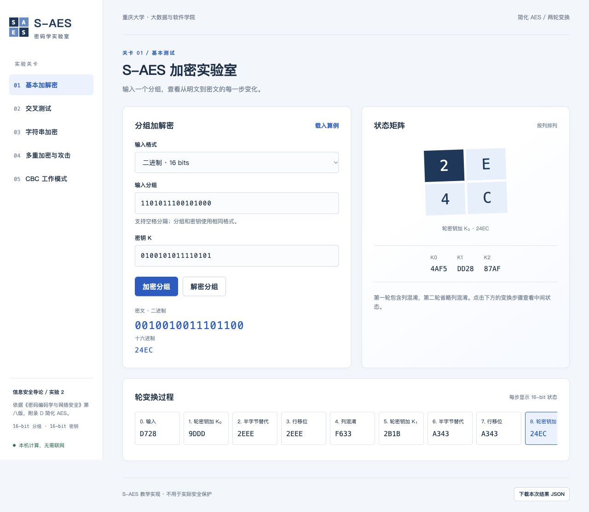

# S-AES 加密实验室

《信息安全导论》实验 2：按照《密码编码学与网络安全——原理与实践》第八版附录 D 实现简化 AES，并完成多重加密、中间相遇攻击与 CBC 篡改实验。

使用 Python 标准库和原生 HTML/CSS/JavaScript。图形界面运行在本机浏览器，无需 Qt、数据库、Node.js 或第三方 Python 运行依赖。**S-AES 是教学算法，不用于真实数据安全保护。**



## 运行

安装 Python 3.10 或更高版本，在本目录执行：

```bash
python3 app.py
```

程序会打开 `http://127.0.0.1:8765`。macOS 也可双击 `启动实验.command`；Windows 可双击 `start.bat`，或执行 `py -3 app.py`。按 Ctrl+C 停止服务。

若端口占用：

```bash
python3 app.py --port 8766
```

仅启动服务、不自动打开浏览器：

```bash
python3 app.py --no-browser
```

## 五关功能

| 关卡 | 实现 |
| --- | --- |
| 1 基本测试 | 16-bit 明文/密钥，加解密，二进制与十六进制，轮密钥和逐步状态矩阵 |
| 2 交叉测试 | 交换 JSON 测试向量，逐项比较加密与解密结果，导出结果 |
| 3 扩展功能 | ASCII 字符串，每组 2 字节，PKCS#7 填充，HEX 与字节字符的 JSON 转义表示 |
| 4 多重加密 | 双重 EE（32 bits）、三重 EDE（32/48 bits），完整密钥空间中间相遇攻击 |
| 5 工作模式 | CBC 长消息加解密，随机或指定 IV，密文位翻转/整组替换，解密分组逐项对比 |

## 测试与证据

```bash
python3 -m unittest discover -v
python3 verify.py
```

`verify.py` 会运行测试并生成：

- `artifacts/unittest.txt`：完整自动化测试日志。
- `artifacts/verification.json`：五关可复现输入、输出与攻击统计。

当前有 24 项测试，含附录 D 的变换算例、独立参考实现的 512 组随机对照、固定密钥下全部 65,536 个明文往返、完整空间 MITM、CBC 篡改、8192 字节消息边界及真实 HTTP 测试。真实界面截图保存在 `artifacts/01-basic.png` 至 `05-cbc-tamper.png`。

标准演示：`P=D728, K=4AF5`，加密结果 `C=24EC`。附录变换算例：`P=A749, K=2D55`，结果 `C=C349`。

## 文档

- [用户指南](docs/用户指南.md)：五个关卡的操作步骤、示例和常见错误。
- [开发手册](docs/开发手册.md)：算法约定、模块接口、HTTP API 和维护方式。
- [测试报告](docs/测试报告.md)：各关卡结果、截图、CBC 实验分析及验证边界。
- [需求与来源](docs/任务要求与来源.md)：石墨要求与课件、附录的对应关系。
- [组间交叉测试记录](docs/组间交叉测试记录.md)：与其他小组交换数据后填写。
- [提交检查表](docs/提交检查表.md)：GitHub/Gitee 发布与课程登记步骤。

## 文件结构

```text
app.py                  本地 HTTP 服务与参数校验
saes.py                 S-AES、EE/EDE、MITM、字节编码、CBC
verify.py               五关证据生成与测试入口
static/                 图形界面与可交换测试向量
tests/                  自动化测试、独立矩阵参考实现
docs/                   用户指南、开发手册、测试报告
artifacts/              实际验证结果与界面截图
启动实验.command        macOS 启动入口
start.bat               Windows 启动入口
```

## 提交状态

代码、测试结果、截图及文档已上传到 GitHub 私有仓库：[yoyuzh/saes-lab](https://github.com/yoyuzh/saes-lab)。**真实同学小组间交叉测试、完整组员信息与石墨提交登记仍需完成**，不得将独立参考实现的对照测试填成已完成的真实组间测试。

私有仓库默认仅向已有权限的账号开放。正式交给教师评阅前，需要邀请教师访问，或由仓库所有者决定是否改为公开。

石墨要求 3 人一组，PPT 第 43 页写 2 人一组，本项目按石墨文档记录 3 人要求。截止时间原文为 **2026 年 10 月 31 日 23:00**，课程未注明时区，提交时以教师/课程平台的时间为准。

课程 PDF 和 PPT 用于核对算法，不纳入公开发布的源代码包。
