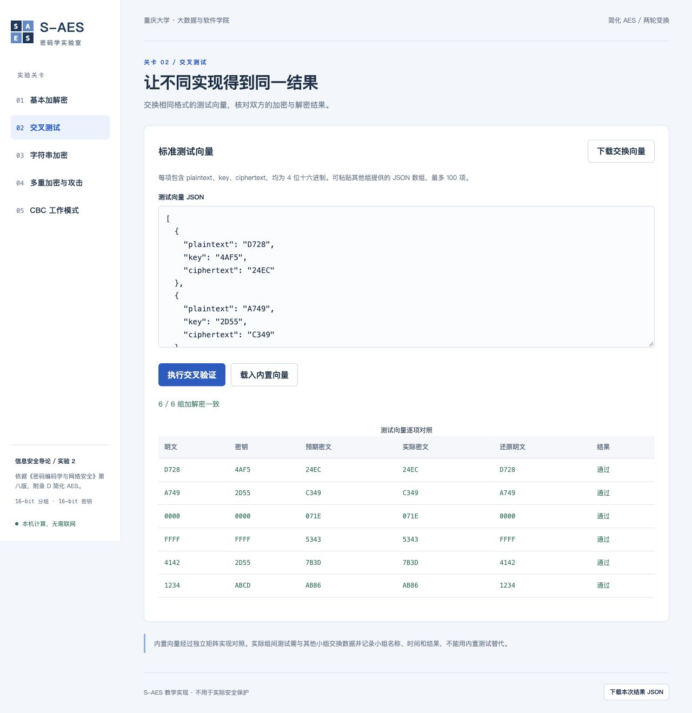
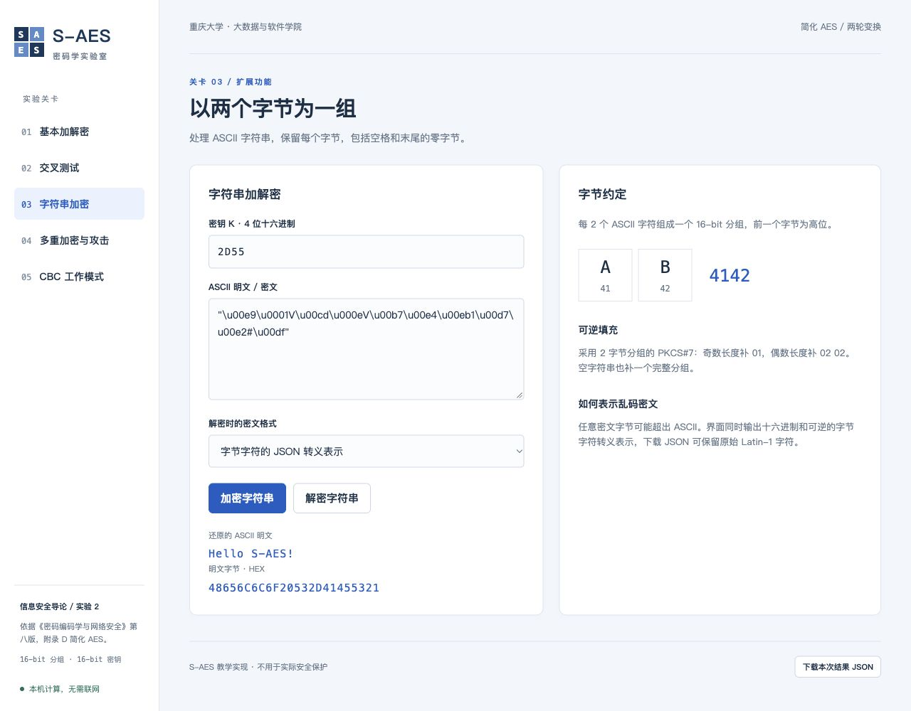
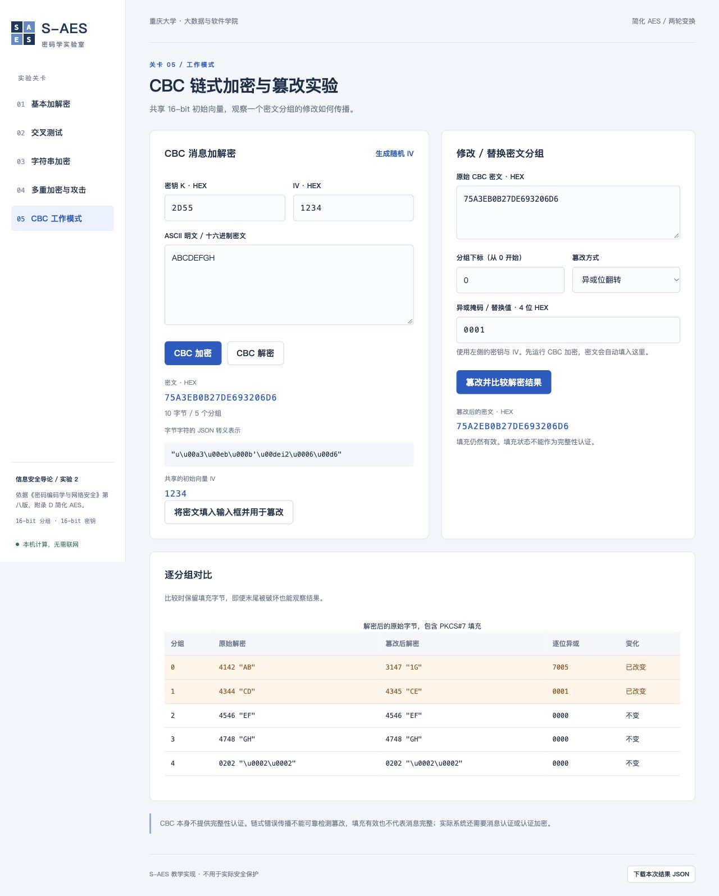
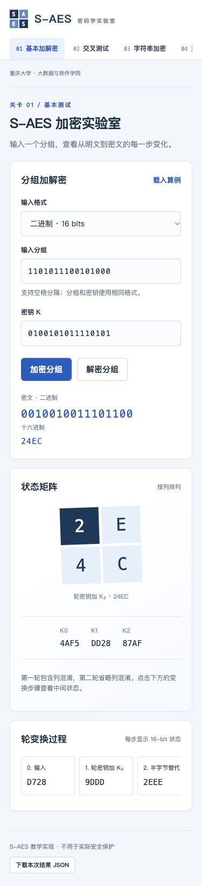

# S-AES 实验测试报告

验证日期：2026-10-26。实验依据、算法约定和资料位置见《任务要求与来源》《开发手册》。所有列出的数值来自实际运行，原始数据在 `artifacts/verification.json`，完整测试日志在 `artifacts/unittest.txt`。

## 验证范围与状态

已完成五关功能实现、算法一致性检查、真实本地 HTTP 验证和浏览器操作。自动化测试 **24 项全部通过**，无失败、无跳过。应用核心 `saes.py` 和服务层 `app.py` 合计语句覆盖率 **91%**（算法层 97%、服务层 88%）。详见 `artifacts/coverage.json` 和 `artifacts/checks.txt`。

运行环境：macOS，Python 3.14.7；额外覆盖率工具在隔离环境中运行。应用声明支持 Python 3.10+；本次没有在 Windows/Linux 主机上实际运行，也没有测试所有旧版浏览器。

**真实同学小组间的交叉测试尚未发生**。下面的独立实现和内置向量测试证明本地标准一致性，不冒充其他小组的结果。成果已上传 GitHub 公开仓库 `yoyuzh/saes-lab`；石墨登记尚未执行。

## 第 1 关：基本测试

### 附录 D 校验

| 校验项 | 预期与实际 |
| --- | --- |
| D.3 密钥扩展，K=2D55 | K0=2D55，K1=BCE9，K2=A34A |
| 半字节替代 | 8A1C → 604C |
| 行移位 | 604C → 6C40 |
| 列混淆 | 6C40 → 3743 |
| GF(2^4) 乘法 | 4 × C = 5 |
| 按附录变换例组合 | P=A749，K=2D55，C=C349 |

这些单步例子直接对应附录 D 中的状态矩阵，避免只检查加解密互逆而漏掉排列或参数错误。

### 16-bit 加解密

| 项目 | 二进制 | HEX |
| --- | --- | --- |
| 明文 | 1101011100101000 | D728 |
| 密钥 | 0100101011110101 | 4AF5 |
| 密文 | 0010010011101100 | 24EC |
| 解密还原 | 1101011100101000 | D728 |

轮密钥 `4AF5 / DD28 / 87AF`。加密过程实际状态为：

```text
D728 → 9DDD → 2EEE → 2EEE → F633 → 2B1B → A343 → A343 → 24EC
输入    AK0    NS1    SR1    MC1    AK1    NS2    SR2    AK2
```

固定 `K=2D55` 遍历全部 **65,536** 个明文，均满足 `D(E(P,K),K)=P`。还遍历全部 65,536 个状态，检查半字节替代与列混淆各自的逆操作。


## 第 2 关：交叉测试

独立参考实现在 `tests/reference_cipher.py`：采用二维状态矩阵、按多项式长除法实现有限域乘法，未导入 `saes.py`。以固定随机种子 `20261026` 选择 **512** 个明文/密钥对，比对被测加密结果，并用被测解密还原参考密文，全部通过。

GUI 内置交换向量的实际结果：

| 明文 | 密钥 | 参考密文 | 本实现密文 | 解密还原 |
| --- | --- | --- | --- | --- |
| D728 | 4AF5 | 24EC | 24EC | D728 |
| A749 | 2D55 | C349 | C349 | A749 |
| 0000 | 0000 | 071E | 071E | 0000 |
| FFFF | FFFF | 5343 | 5343 | FFFF |
| 4142 | 2D55 | 7B3D | 7B3D | 4142 |
| 1234 | ABCD | AB86 | AB86 | 1234 |

另外人为把预期密文填成 `0000`，系统会报告不一致。`static/vectors.json` 可供真实同学交换；真实组间结论请填写《组间交叉测试记录》。



## 第 3 关：ASCII 字符串

明文 `Hello S-AES!`，密钥 `2D55`，PKCS#7 填充后加密得到：

```text
E90156CD0E56B7E4EB31D7E223DF
```

在 GUI 中先加密，再用「字节字符的 JSON 转义表示」回填并解密，准确还原 `Hello S-AES!`。HEX 解密也在服务测试中通过。

边界覆盖：空串、1 字节、2 字节、奇数长度、偶数长度、末尾零字节、全部 ASCII 字节、底层 bytes 的 0–255 值以及 8192 字节长消息。不同长度均可完整往返；非法填充、半个分组、非 ASCII 明文会被拒绝。

修复并回归了浏览器回车问题：明文 `" o"`（前导空格），密钥 `2D55`，密文 `0D2523DF`。以 `"\r%#\u00df"` 形式回填，解密还原前导空格与字母 o，避免 textarea 改变 CR 字节。



## 第 4 关：多重加密

### 双重与三重

| 模式 | 密钥 | 明文 | 密文 | 解密还原 |
| --- | --- | --- | --- | --- |
| 双重 EE | F123FE98 | D728 | 3476 | D728 |
| 三重 EDE / 32 bits | F123FE98 | D728 | 418A | D728 |
| 三重 EDE / 48 bits | F123FE985678 | D728 | 8913 | D728 |

三重 32-bit 模式使用 K3=K1，48-bit 模式使用独立 K3。自动化测试还检查 K1=K2 时两密钥 EDE 退化为单次加密的性质。

### 中间相遇攻击

攻击目标为双重 EE，真实组合密钥 `F123FE98`。使用三组已知对：

```text
D728 3476
1234 BC23
FFFF 5EA4
```

枚举 K1、K2 各 **65,536** 个，包含高位非零的密钥，未缩小搜索范围。

| 已知信息 | 首组匹配 | 符合全部已知对的候选 |
| --- | --- | --- |
| 第一组 | 65,568 | 65,568 |
| 三组 | 65,568 | 1：F123FE98 |

GUI 本次完整搜索耗时约 0.26 秒，具体时间随机器与缓存状态变化；可复现脚本记录的准确运行时间见原始 JSON。碰撞桶保留所有 K1，不因同一中间值覆盖候选。仅凭一个已知对不能唯一确认密钥。


## 第 5 关：CBC 与篡改

明文 `ABCDEFGH`，密钥 `2D55`，共享 IV `1234`，得到密文：

```text
75A3 EB0B 27DE 6932 06D6
```

正常解密准确还原。消息为偶数字节，最后一个明文分组为填充 `0202`。自动生成 IV 的加解密也通过测试；固定输入而改变 IV 时密文改变。

### 位翻转

修改第 0 个密文分组，`75A3 XOR 0001 = 75A2`，其余密文不变。实际解密结果：

| 明文分组下标 | 篡改前 | 篡改后 | XOR | 结论 |
| --- | --- | --- | --- | --- |
| 0 | 4142（AB） | 3147（1G） | 7005 | 本分组发生非线性变化 |
| 1 | 4344（CD） | 4345（CE） | 0001 | 下一分组对应一位翻转 |
| 2 | 4546（EF） | 4546（EF） | 0000 | 不变 |
| 3 | 4748（GH） | 4748（GH） | 0000 | 不变 |
| 4 | 0202（填充） | 0202（填充） | 0000 | 不变 |

### 分组替换

把第 0 个密文分组直接替换为 `0000`，解密第 0 分组变为 `A349`，第 1 分组变为 `36E7`，其余仍不变。原始结果记录在 `verification.json` 的 `cbc.replacement` 中。

### 分析

对于 `Pi=D(K,Ci) XOR C(i-1)`，修改 Ci 会改变 Pi，并通过下一分组的异或使 P(i+1) 按相同差分翻转。由于之后的密文不变，再后面的明文保持原值。修改 IV 仅按差分改变第一个明文分组，测试也验证了这一点。

本例尾部填充仍有效，系统并不能仅凭 CBC/填充判断消息是否遭篡改。错误传播是可观察现象，不能替代 MAC 或认证加密。



## 界面与服务检查

已在真实本地服务和浏览器验证：

- 基础加密与解密、格式切换所需接口、逐轮矩阵输出。
- 六组向量对照、ASCII 转义往返、特殊回车字节往返。
- 双重加密、三重 48-bit 加解密及完整空间 MITM。
- CBC 加密、解密、位翻转和整组替换。
- 结果 JSON 的真实下载及内容核对。
- 非法分组提示；请求失败时清除旧轮变换和状态，禁用旧结果导出。
- 桌面 1280px 和移动 375px 宽度，页面根节点无水平溢出，长表格/步骤在各自区域滚动。
- 真实 HTTP 对静态资源、加密接口、错误 JSON、大小上限、来源限制和路径白名单的检查。



## 复现命令

```bash
python3 -m unittest discover -v
python3 verify.py
```

可选静态/覆盖率检查：

```bash
node --check static/app.js
uv run --with ruff ruff check saes.py app.py verify.py tests --select E9,F63,F7,F82,F401
uv run --with coverage coverage run -m unittest discover
uv run --with coverage coverage report -m
```

JavaScript 语法检查、上述 ruff 规则和覆盖率阈值检查均已通过。覆盖率未执行部分主要为命令行入口、浏览器启动和若干异常分支；命令行服务的真实启动另有实际运行证据。测试覆盖率不代表所有平台与场景都已验证。
