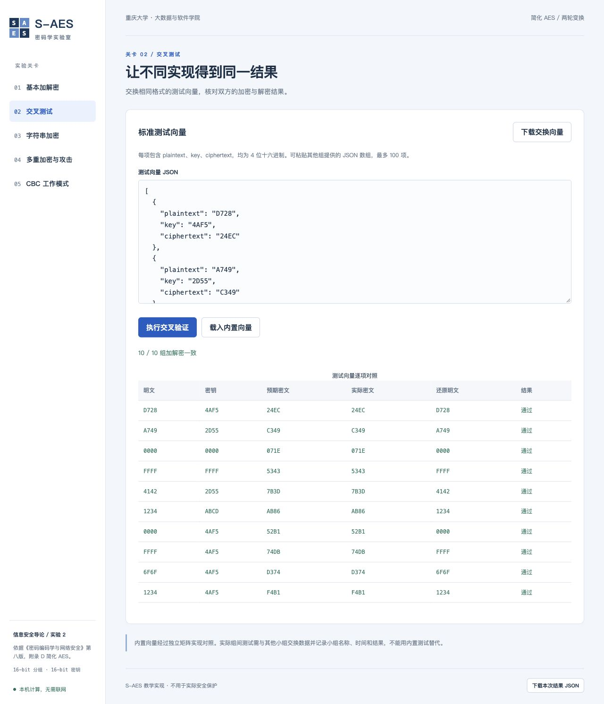

# 与三点水小组的交叉测试记录

本组使用三点水小组提供的实际仓库源码完成双向交叉测试：10 组固定向量、512 组随机向量，522 组全部通过。测试在本组 macOS 环境运行双方源码完成，未声称对方成员在其设备上现场操作或签字确认。

## 1. 小组及版本

| 项目 | 实际信息 |
| --- | --- |
| 本组成员 | 游雨哲，学号 20240940；冯羿瑞，学号 20240179 |
| 本组人数 | 2 人 |
| 对方小组 | 三点水小组 |
| 本组仓库 | <https://github.com/yoyuzh/saes-lab> |
| 本组测试基础提交 | `5768c402ca13bd0158735f7e20044b128f58b796`，后续更新仅补充成员与测试资料 |
| 三点水小组仓库 | <https://github.com/wen-yan-chen/pro_2_SAES> |
| 对方固定提交 | `91771295a319d40ced8e1eb9eabf2279f9d520a4` |
| 本次运行环境 | macOS 27.2 / ARM64，Python 3.14.7，双方算法均在此环境运行 |
| 测试时间 | 2026-10-26 04:43:12，UTC-07:00（America/Los_Angeles） |

## 2. 测试方法

A 端为本组 `saes.py` 的 `encrypt_block/decrypt_block`，B 端为三点水小组仓库 `saes/core.py` 的 `s_aes_encrypt/s_aes_decrypt`。对方源码在独立模块名下加载，没有改写或替换其算法函数。

每例使用相同的 16-bit 明文 P 和密钥 K，执行：

1. A、B 两端分别加密，比较两份实际密文是否一致。
2. 将 B 生成的实际密文交给 A 解密，检查是否还原 P。
3. 将 A 生成的实际密文交给 B 解密，检查是否还原 P。

固定向量包括本组的 6 组交换向量，以及对方报告使用的另外 4 组分组。随机测试使用种子 `20261026` 生成 512 个明文/密钥对。固定向量又通过本组实际运行的 HTTP `/api/cross` 接口复核，10/10 通过。

## 3. 固定向量实际结果

全部数值均为 HEX，分组、子密钥各 4 位。表中两端的加密及解密列均为本次运行各自函数得到的结果。

| 明文 P | 密钥 K | 本组加密 | 三点水程序加密 | 本组解对方密文 | 三点水程序解本组密文 | 结果 |
| --- | --- | --- | --- | --- | --- | --- |
| D728 | 4AF5 | 24EC | 24EC | D728 | D728 | 通过 |
| A749 | 2D55 | C349 | C349 | A749 | A749 | 通过 |
| 0000 | 0000 | 071E | 071E | 0000 | 0000 | 通过 |
| FFFF | FFFF | 5343 | 5343 | FFFF | FFFF | 通过 |
| 4142 | 2D55 | 7B3D | 7B3D | 4142 | 4142 | 通过 |
| 1234 | ABCD | AB86 | AB86 | 1234 | 1234 | 通过 |
| 0000 | 4AF5 | 52B1 | 52B1 | 0000 | 0000 | 通过 |
| FFFF | 4AF5 | 74DB | 74DB | FFFF | FFFF | 通过 |
| 6F6F | 4AF5 | D374 | D374 | 6F6F | 6F6F | 通过 |
| 1234 | 4AF5 | F4B1 | F4B1 | 1234 | 1234 | 通过 |

## 4. 随机数据与汇总

| 检查 | 固定向量 | 随机向量 | 总计 |
| --- | --- | --- | --- |
| 两端加密一致 | 10/10 | 512/512 | 522/522 |
| 本组解对方密文正确 | 10/10 | 512/512 | 522/522 |
| 对方程序解本组密文正确 | 10/10 | 512/512 | 522/522 |

失败用例：0。每个随机用例的 P、K、两端密文和两端解密结果均保存在原始 JSON 中，可逐项复核。

## 5. 证据

- [完整 522 组原始结果](../artifacts/三点水小组交叉测试结果.json)：包含测试时间、双方版本、源码 SHA-256、执行环境和逐项结果。
- [三点水程序生成的固定交换向量](../artifacts/三点水小组交换向量.json)：可粘贴到本组 GUI 的「交叉测试」关卡，复核对方实际生成的密文。
- [真实 GUI 复核截图](../artifacts/07-cross-sandianshui.png)：将对方程序生成的 10 组固定密文导入本组界面，10/10 通过。
- 本组程序原有 24 项自动化测试与内部独立实现对照仍单独记录，不计入上述 522 组以免混淆来源。



## 6. 结论与兼容边界

在本次固定版本和测试范围内，本组程序与三点水小组程序的 16-bit S-AES 加密结果一致，双方实际生成的密文均能被另一端正确解密，满足第 2 关的分组算法交叉验证要求。

本次由本组运行双方源码，未验证对方 GUI，也未在对方设备或 Windows/Linux 主机上运行。三点水小组程序的字符串/CBC 使用零填充，本组使用 PKCS#7；交换完整消息时需要统一填充约定。本记录不把分组互通扩大为所有默认消息格式完全兼容。

## 7. 复现方法

在本组项目根目录执行。若对方仓库目录已存在，可跳过 clone，随后 checkout 固定提交。

```bash
git clone https://github.com/wen-yan-chen/pro_2_SAES.git tmp/third-party/pro_2_SAES
git -C tmp/third-party/pro_2_SAES checkout --detach 91771295a319d40ced8e1eb9eabf2279f9d520a4
python3 - <<'PY'
import importlib.util
import json
import random
from pathlib import Path
import saes

path = Path('tmp/third-party/pro_2_SAES/saes/core.py')
spec = importlib.util.spec_from_file_location('peer_core', path)
peer = importlib.util.module_from_spec(spec)
spec.loader.exec_module(peer)
fixed = json.loads(Path('static/vectors.json').read_text())
pairs = [(int(row['plaintext'], 16), int(row['key'], 16)) for row in fixed]
pairs += [(p, 0x4AF5) for p in (0x0000, 0xFFFF, 0x6F6F, 0x1234)]
rng = random.Random(20261026)
pairs += [(rng.randrange(65536), rng.randrange(65536)) for _ in range(512)]
for plaintext, key in pairs:
    our_cipher = saes.encrypt_block(plaintext, key)
    peer_cipher = peer.s_aes_encrypt(plaintext, key)
    assert our_cipher == peer_cipher
    assert saes.decrypt_block(peer_cipher, key) == plaintext
    assert peer.s_aes_decrypt(our_cipher, key) == plaintext
print(f'{len(pairs)} cases passed in both directions')
PY
```
